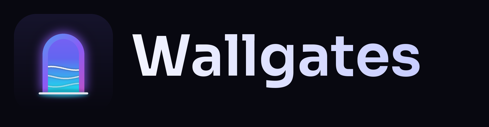
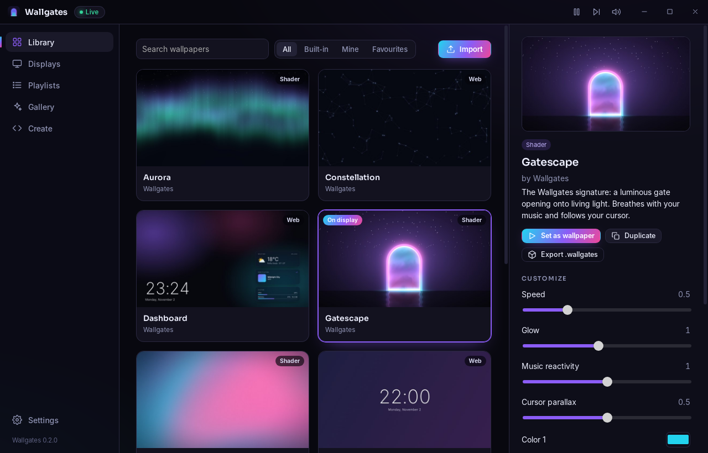

<div align="center">



### Live wallpapers, open to everyone.

**Wallgates** is a free, open-source live wallpaper engine for Windows (and Linux).
Shaders, web pages, videos and images on your desktop, with every option in your hands,
no Steam, no account and no telemetry.

[](https://github.com/CerLioX17/WallGates/actions/workflows/build.yml)
[](https://github.com/CerLioX17/WallGates/releases/latest)
[](LICENSE)

**[⬇ Download for Windows](https://github.com/CerLioX17/WallGates/releases/latest)** · [Create wallpapers](docs/wallpaper-format.md) · [Roadmap](ROADMAP.md)



</div>

## Why Wallgates

Wallgates was designed from the most common complaints about existing wallpaper engines.

| Problem elsewhere | Wallgates |
| --- | --- |
| FPS drops in games; pause only reacts to the focused window | Pauses when **any** window covers a display, including borderless games, overlays filtered out. You choose **Pause, Eco or Unload (frees GPU memory)** per situation |
| Wallpapers lost or shuffled after sleep or reconnecting a monitor | Displays are identified by their **hardware ID**, not by `DISPLAY1`/`DISPLAY2` |
| Wallpaper disappears after Explorer restarts or on new Windows builds | A **watchdog** re-attaches automatically (confirmed on Windows 11 26H2) |
| Autostart broken by a Windows service blocked by antivirus | Plain per-user autostart, **no service, no admin, no hooks** |
| Malware in "application" wallpapers | Wallgates **never runs executables**. Web wallpapers are **sandboxed and offline by default** |
| Locked into Steam | No Steam, no account. Import your **Wallpaper Engine video & web wallpapers** in one click |
| Rainmeter needed for widgets | Wallpapers can show **weather, now playing, CPU/RAM**, with permissions you can see |
| No editor for code, or a steep one | Built-in **live editor**: type, and the desktop updates with compile errors shown inline |
| Coarse day/night playlists | Playlists by **interval, shuffle or time of day, including real sunrise/sunset** for your city |
| Lock screen ignored | Optional **lock screen & Windows background sync** |

## Features

- **Four wallpaper types**: GPU shaders (Shadertoy-style GLSL), HTML/JS, video, images.
- **Live customization**: each wallpaper declares sliders, colors, toggles, lists and text, and changes apply instantly.
- **Multi-monitor**: a different wallpaper per display, or one spanning all displays.
- **Playlists**: rotate every N minutes (with shuffle) or switch by time of day / sunrise / sunset, with crossfade transitions.
- **Audio-reactive**: system audio spectrum (what you hear, not the microphone) for shaders and web wallpapers.
- **Interactive**: cursor parallax, now playing (Spotify, browsers, any media app), weather (Open-Meteo, no key).
- **Market Terminal**: your ISIN watchlist and portfolio with live P/L, intraday charts, index tape and world market clocks.
- **System Terminal**: CPU, GPU, RAM and SSD load and temperatures, top processes, network, fans and weather with UV and a 4-day forecast, in a clean terminal-style monitor.
- **Advanced sensors built in**: one click in Settings adds CPU/RAM temperatures and fans (LibreHardwareMonitor + PawnIO). Nothing else to install, and uninstalling Wallgates removes it too.
- **Performance controls**: frame cap, render quality (great on 4K), eco mode, per-app rules (`game.exe → Unload`), mute unless the desktop is in front.
- **Create & share**: built-in live code editor, templates, `.wallgates` packages (double-click to install), curated online gallery.
- **Migrate**: import Wallpaper Engine **video** and **web** projects, or point it at your whole `workshop/content/431960` folder. Web wallpapers keep working thanks to a compatibility layer.
- **Shortcuts & tray**: pause, next wallpaper, mute, from anywhere.
- **English and Italian** interface.

## Install

1. Download `Wallgates_x.y.z_x64-setup.exe` from the **[latest release](https://github.com/CerLioX17/WallGates/releases/latest)**.
2. Run it. It installs for your user only, no admin rights needed.

> **"Windows protected your PC"?** New, independent apps show this until they build download
> reputation. Click **More info → Run anyway**. Every release lists SHA-256 checksums, and the
> code is open for anyone to audit. Signed builds are on the way: see [distribution & signing](docs/distribution.md).

Wallgates lives in the system tray: closing the window keeps your wallpaper running.

## Create a wallpaper

A wallpaper is a folder with a `wallpaper.json`:

```json
{
  "name": "My Wallpaper",
  "type": "shader",
  "entry": "main.frag",
  "capabilities": ["audio"],
  "properties": {
    "speed": { "label": "Speed", "type": "slider", "min": 0, "max": 3, "default": 1 }
  }
}
```

Or open **Create** in the app, pick a template and start typing: your desktop updates live.
Full reference: **[docs/wallpaper-format.md](docs/wallpaper-format.md)**. The built-in wallpapers in
[`wallpapers/`](wallpapers) and the gallery items in [`gallery/`](gallery) are working examples.

## Build from source

Requirements: [Rust](https://rustup.rs), Node.js 20+, and the [Tauri prerequisites](https://v2.tauri.app/start/prerequisites/).

```bash
npm install
npm run dev      # run in development
npm run build    # produce installers in src-tauri/target/release/bundle
```

## Platform support

| Platform | Status |
| --- | --- |
| Windows 10 / 11 (incl. 24H2, 25H2, 26H2) | ✅ Full: behind icons, multi-monitor, auto-pause, audio, media, lock screen |
| Linux (X11) | ✅ Wallpapers, playlists, editor. Auto-pause, audio and media are planned |
| Linux (Wayland), macOS | 🛠 Planned, see the [roadmap](ROADMAP.md) |

## Privacy

Wallgates has **no telemetry and no accounts**. It contacts the network only for:
the gallery (GitHub), the update check (GitHub), and weather (Open-Meteo), each of which can be switched off in Settings.
Wallpapers are offline unless they declare the `network` capability.

## Project layout

```
src-tauri/src/
  engine.rs        per-display state, pause/eco/stop rules, playlists, feeds, watchdog
  desktop/         Windows WorkerW integration, desktop observation, Linux/X11
  feeds/           audio (WASAPI loopback + FFT), media, system, weather, sun times
  library.rs       wallpapers, manifests, editor file access
  package.rs       .wallgates packages, Wallpaper Engine import
  protocol.rs      wp:// file server (path-safe, HTTP range, offline CSP)
ui/                settings app (index/app.js) and wallpaper host (host.js), SDK
wallpapers/        built-in wallpapers        gallery/   online gallery items
branding/          logo & installer art generator
```

## Support the project

Wallgates is free and open source. If you like it, ⭐ **star the repo** and share it. That is what
builds the download reputation that makes Windows trust new apps.

## License

[GPL-3.0-or-later](LICENSE). The SDK files in `ui/sdk/` are MIT so wallpapers can use any licence.
Built-in wallpapers are CC BY 4.0. Wallgates is not affiliated with Wallpaper Engine or Valve.
