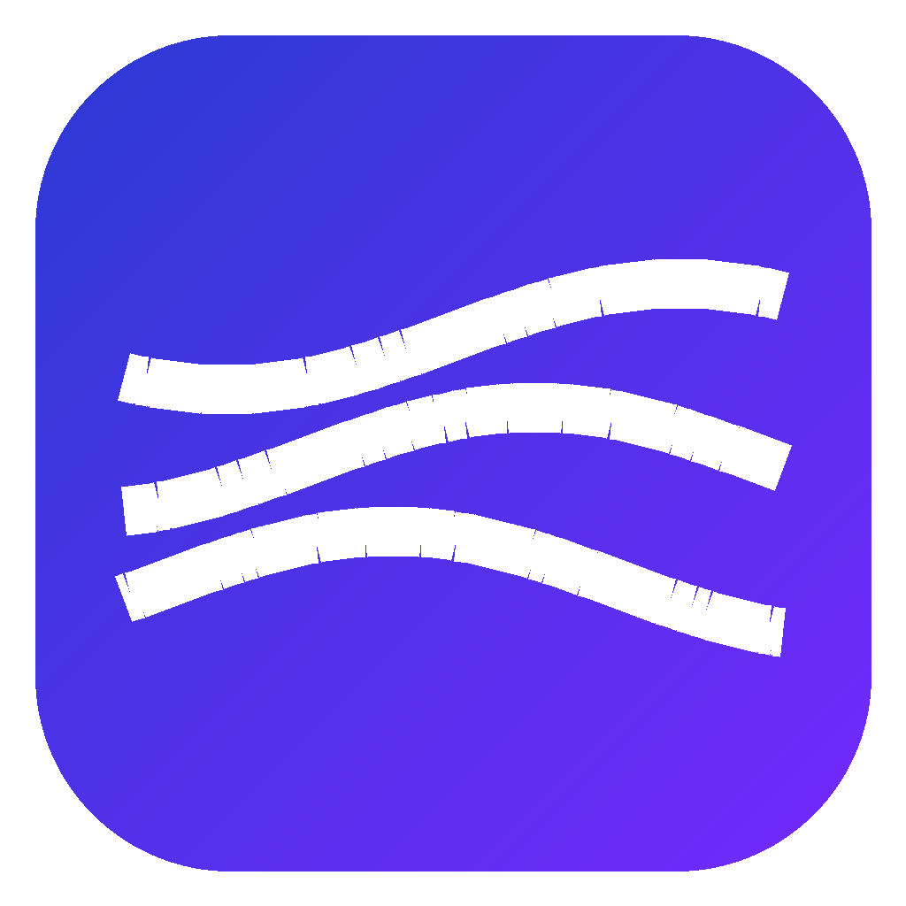

<div align="center">



# Wallgates

**Open-source, fully customizable live wallpaper engine.**
Shaders, web pages, videos and images on your desktop, with every option in your hands.

[](https://github.com/CerLioX17/WallGates/actions/workflows/build.yml)
[](LICENSE)


</div>

## Features

- **Four wallpaper types**: GPU shaders (Shadertoy-style GLSL), HTML/JS pages, videos, images.
- **Live customization**: every wallpaper declares its own options (sliders, colors, toggles, lists, text) and changes apply instantly.
- **Behind your icons**: renders under the desktop icons on Windows 10 and 11 (including 24H2), on every monitor.
- **Light on resources**: built on Tauri (system WebView, no bundled Chromium). Auto-pauses when a game or fullscreen app is running, optionally on maximized windows or on battery, and has a frame cap for shaders.
- **Import in one click**: pick any image or video and it becomes a wallpaper with fit / speed / volume controls.
- **Safe by design**: third-party HTML wallpapers run in a sandboxed iframe with no access to the app or your files.
- **Easy to create for**: a folder with a `wallpaper.json` is a wallpaper. See the [format guide](docs/wallpaper-format.md).

## Install

Download the latest installer from **[Releases](../../releases)**:

- Windows: `.msi` or `-setup.exe`
- Linux: `.deb` or `.AppImage` (X11, see the platform notes)

Wallgates lives in the system tray. Closing the window keeps your wallpaper running; use **Quit** from the tray icon to stop it.

## Build from source

Requirements: [Rust](https://rustup.rs), Node.js 20+, and the [Tauri prerequisites](https://v2.tauri.app/start/prerequisites/) for your OS (WebView2 is preinstalled on Windows 10/11).

```bash
npm install
npm run dev      # run in development
npm run build    # produce installers in src-tauri/target/release/bundle
```

## Create a wallpaper

```
my-wallpaper/
├── wallpaper.json
└── index.html
```

```json
{
  "name": "My Wallpaper",
  "type": "html",
  "entry": "index.html",
  "properties": {
    "color": { "label": "Color", "type": "color", "default": "#6c8cff" }
  }
}
```

The full reference, including shaders and the `postMessage` API, is in [docs/wallpaper-format.md](docs/wallpaper-format.md). The built-in wallpapers in [`wallpapers/`](wallpapers) are working examples.

## Platform notes

| Platform       | Status                                                                        |
| -------------- | ----------------------------------------------------------------------------- |
| Windows 10/11  | Supported: behind icons, multi-monitor, auto-pause                            |
| Linux (X11)    | Supported: desktop-type window. Auto-pause not implemented yet                |
| Linux (Wayland)| Planned (wlr-layer-shell)                                                     |
| macOS          | Planned. It currently shows a borderless window, not yet behind icons          |

## Project layout

```
src-tauri/src/
  lib.rs           app state, commands, tray, auto-pause loop
  library.rs       wallpaper discovery, manifests, import
  protocol.rs      wp:// file server (path-safe, HTTP range for video)
  desktop/         per-OS desktop integration (WorkerW on Windows, X11 hint on Linux)
ui/
  index.html/app.js  settings window
  host.html/host.js  wallpaper renderer (one window per monitor)
wallpapers/        built-in wallpapers
```

## Roadmap

See [ROADMAP.md](ROADMAP.md). Contributions are welcome. Open an issue before large changes.

## License

[GPL-3.0-or-later](LICENSE). Wallpapers you create are your own work and you choose their licence.
Wallgates is not affiliated with any other wallpaper software.
